# 2D Camera Follow Lab

[日本語](README.md) | **English**

**▶ Play it in your browser: https://kumi0708.github.io/2d-camera-follow-lab/**

<p align="center">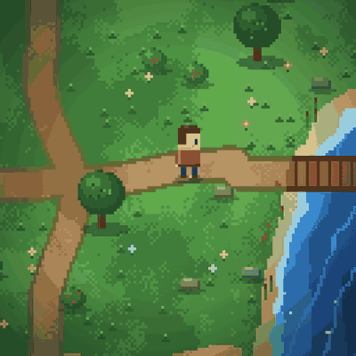</p>

A demo that lets you switch between eight 2D camera follow styles in the same world and compare them.
It implements the SpriteCook article "[2D camera follow: dead zone & look-ahead](https://www.spritecook.ai/blog/2d-camera-follow-dead-zone-look-ahead)".

Every animation on this page is the demo's real screen, and every chart is drawn by running `camera.js` itself (see [How the figures are made](#how-the-figures-are-made)).

## Running it

The code uses ES modules, so open it through a local server. There are no dependencies.

```bash
node serve.mjs
```

Then open http://localhost:8123. Change the port with the `PORT` environment variable or the first argument.

## Controls

| Key | Action |
| --- | --- |
| WASD / arrow keys | Move |
| Shift | Run |
| 1–8 | Switch mode |
| IJKL | Move the slime buddy (for two targets) |
| Mouse | Aim |
| G | Toggle debug overlay |
| P | Toggle pixel snapping |
| R | Reset |

The side panel has live sliders for each mode's parameters, a graph of the camera's offset from the player, and a minimap.

## Modes at a glance

Defaults assume a 128×128 px view at 60 ticks per second. Scale pixel values with your view size.

| # | Mode | How it works | Defaults |
| --- | --- | --- | --- |
| 1 | Locked | `cam = p` | — |
| 2 | [Smooth](#2-smooth) | Exponential ease toward the player | rate 2.6/s |
| 3 | [Dead zone](#3-dead-zone) | Clamp the camera to a box around the player | half-size x 22 px, y 18 px |
| 4 | [Room by room](#4-room-by-room) | Smoothstep slide to the current room's centre | room 128 px, 0.55 s |
| 5 | [Look-ahead](#5-look-ahead) | Lead ahead using movement direction only | 32 px, rate 3.4/s |
| 6 | [Points of interest](#6-points-of-interest) | Pull toward nearby points with a smoothstep weight | 60 px → 24 px, pull 0.6, rate 3.5 |
| 7 | [Aim offset](#7-aim-offset) | Shift by a share of the cursor's screen offset | 0.45, rate 8 |
| 8 | [Two targets](#8-two-targets) | Follow the midpoint and zoom out with distance | padding 104, view 128–240 px |

## How it works

### Reading the animations

Each mode's animation shows the debug overlay (G key).

| Overlay | Meaning |
| --- | --- |
| White cross | Camera centre (the middle of the screen) |
| Yellow dot and dotted line | The goal the camera is easing toward |
| Cyan dashed box | Dead zone |
| Purple dashed lines | Room borders |
| Pink arrow | Look-ahead lead |
| Green circles | Point-of-interest range (outer 60 px, inner 24 px) |
| Orange reticle | Mouse cursor |
| Cyan line | The line between the two targets |

In the charts, the blue line is the player and the orange line is the camera.

### The common base: a goal plus an ease

The article's core idea is that **every mode splits into two steps: pick a goal, then ease toward it.** Modes differ only in how they pick the goal. The ease is nearly always the same.

```
goal = per-mode calculation(p, ...)
cam += (goal - cam) * (1 - exp(-rate * dt))
```

<p align="center">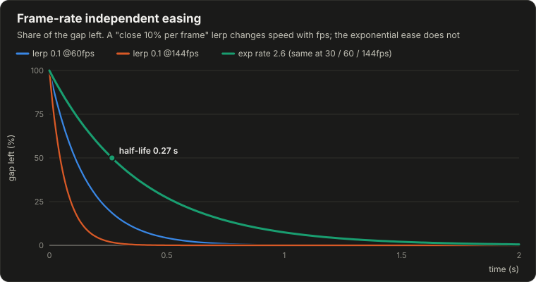</p>

**Why the exponential.** The common `cam = lerp(cam, goal, 0.1)` closes 10% of the gap per frame. As the chart shows, that makes the camera follow at different speeds at 60 fps and 144 fps. Storing rate as a per-second value and using `1 - exp(-rate·dt)` closes the same distance in the same time however dt is sliced (the green line is identical at 30, 60 and 144 fps).

- The remaining gap decays as `exp(-rate·t)`.
- The time to halve the gap (the half-life) is `ln2 / rate`. At rate 2.6 that is about 0.27 s.
- The time to 1% of the gap is `ln(100) / rate ≈ 4.605 / rate`. Use this to convert to Unity Cinemachine's Damping, which is a time.

**A rate of 0 snaps to the goal.** Taken literally the formula would give a factor of 0 and freeze the camera, so it is special-cased (`ease()` in `camera.js`).

**Distances and shares of 0 reproduce the locked camera** in every mode. The article recommends this check, and `test.mjs` runs it for all modes.

**Update order.** On a fixed 60 Hz timestep, each tick runs input → player movement → camera → render. Updating the camera before the player shows a position one tick old and makes the view shimmer. Effects such as screen shake are added on top of the computed camera position, not written over it.

### 1. Locked

```
cam = p
```

The simplest follow, and the baseline the other modes are compared against. Every small movement and jump reaches the screen unchanged.

### 2. Smooth

<p align="center">
  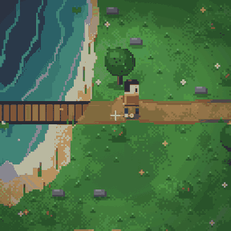
  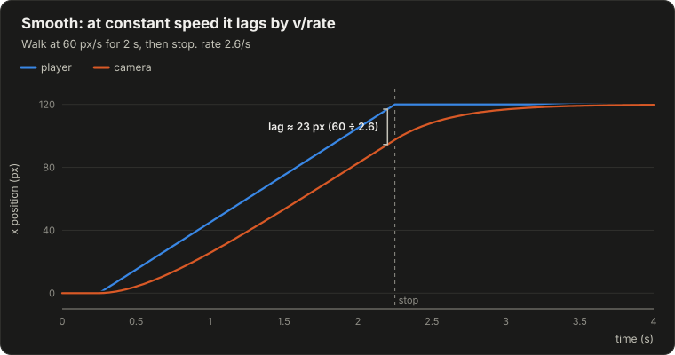
</p>

```
cam += (p - cam) * (1 - exp(-2.6 * dt))
```

Targets the player's position and chases it with an exponential ease. In the animation the player drifts toward the right of the screen while running, and the camera catches up after the stop.

- At 60 Hz it closes about 4.24% of the gap per tick.
- From 100 px away it gets within 1 px after 107 ticks (about 1.78 s).
- **It always lags a little.** At a constant speed v the lag settles at `v / rate`. Walking (60 px/s) gives about 23 px (the chart); running (150 px/s) gives about 58 px, which puts the player close to the screen edge (64 px). This is why fast games need a higher rate.
- Godot's `position_smoothing_speed` closes a linear `speed × delta` share instead, so the same 2.6 closes about 4.33% per tick and takes 104 ticks — slightly different motion.

### 3. Dead zone

<p align="center">
  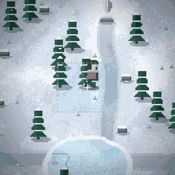
  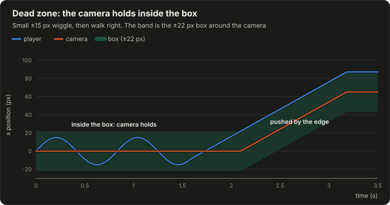
</p>

```
cam.x = clamp(cam.x, p.x - 22, p.x + 22)
cam.y = clamp(cam.y, p.y - 18, p.y + 18)
```

Imagine an invisible box around the camera (44×36 px, about a third of the view). It is the cyan box in the animation.

- While the player is inside the box, the camera does not move at all (the flat start of the chart). Small steps and jumps in place do not shake the view.
- Once the player leaves the box, the player pushes the camera, which stays on the box edge and moves at the same speed. The lag is never more than the box's half-size.
- There is no ease, so when the player stops, the camera stops right there.
- Width and height are set separately.
- In Godot, drag margins do the same thing. The values are a share of half the screen: `22 / 64 = 0.34375` and `18 / 64 = 0.28125`.

### 4. Room by room

<p align="center">
  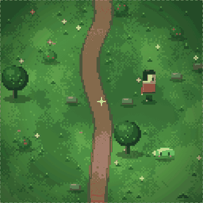
  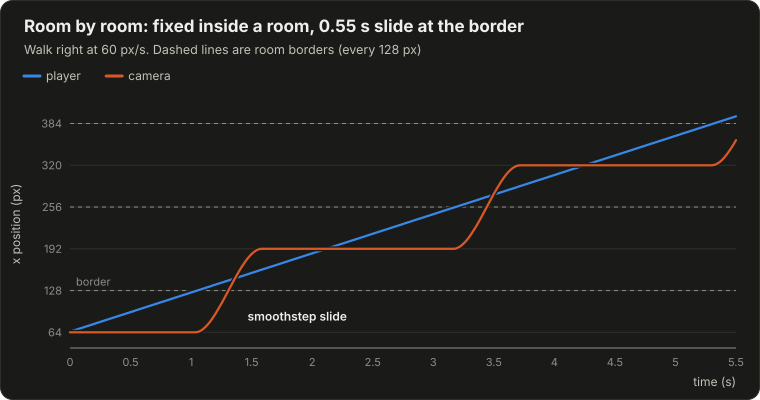
</p>

```
center = floor(p / ROOM) * ROOM + ROOM / 2
if center != room_to:
    room_from = cam; room_to = center; t = 0
t += dt
cam = lerp(room_from, room_to, smoothstep(min(t / 0.55, 1)))
```

Locks the view to one room at a time, familiar from classic top-down action games.

- Inside a room (128 px square) the camera does not move at all (the flat steps in the chart).
- When the player crosses a border, the camera slides to the next room's centre over 0.55 s (33 ticks).
- `smoothstep(t) = t²(3 − 2t)` has zero speed at both ends, so the motion reads as stop → move → stop (the rounded corners of each step).
- The slide starts from the current camera position, so crossing back and forth mid-slide turns the camera around without a jump.
- On the first tick the camera snaps to the starting room instead of sliding. A slide time of 0 cuts on the tick the player crosses.

### 5. Look-ahead

<p align="center">
  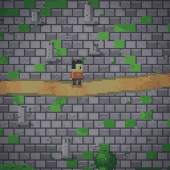
  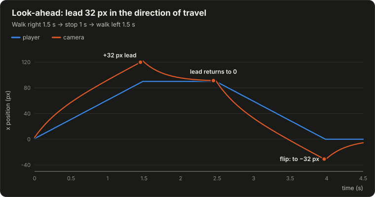
</p>

```
moved = p - last_p;  last_p = p
goal_lead = normalize(moved) * 32 if moved is non-zero, else (0, 0)
lead += (goal_lead - lead) * (1 - exp(-3.4 * dt))
cam = p + lead
```

Shows more of the space in the direction the player is heading. The pink arrow in the animation is the lead.

- **It uses only the direction of movement, not the speed.** Walking and running give the same 32 px lead (a quarter of the view).
- **Only the lead is eased,** not the camera position. The camera stays locked to the player while the forward offset changes smoothly.
- After 1 s of walking the lead is 30.9 px; after 1 s at rest it is back to about 1 px.
- On a direction flip the lead slides across to the other side. It passes the centre after about 0.2 s (`ln2 / 3.4`).
- `last_p` is stored after computing the movement.
- Unity Cinemachine's Lookahead predicts from velocity, so the lead grows with speed (32 px at 60 px/s becomes about 92 px at 3×). For a constant lead, move a separate focus object instead, as the article does.

### 6. Points of interest

<p align="center">
  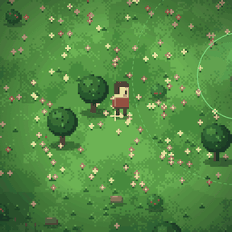
  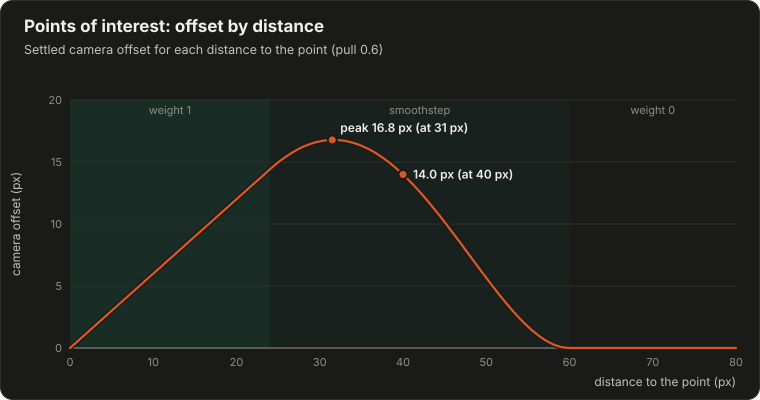
</p>

```
goal = p
for o in points_of_interest:
    w = smoothstep(60, 24, distance(o, p))   // 0 at 60 px, 1 at 24 px
    goal += (o - p) * w * 0.6
cam += (goal - cam) * (1 - exp(-3.5 * dt))
```

Walk near a chest or campfire and the camera leans toward it. The green circles in the animation are the range (outer 60 px, inner 24 px).

- The weight w is 0 beyond 60 px and 1 within 24 px, with a smoothstep between.
- The offset is `distance × w × 0.6`: 14.0 px at 40 px and 14.4 px at 24 px. It peaks at about 31 px (about 17 px of offset), then shrinks as `0.6 × distance` when the player gets closer. Standing on the point puts the camera back on the player.
- Several points add their offsets together.
- A pull of 0 turns the feature off.
- **Pitfall:** two points placed closer together than the pull range can make the camera swing between them. Keep points of interest apart.

### 7. Aim offset

<p align="center">
  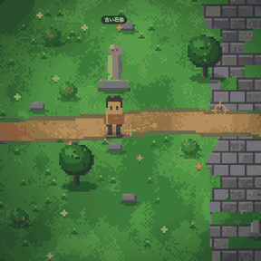
  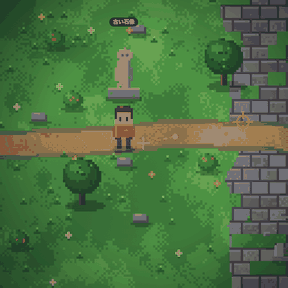
</p>
<p align="center"><sub>Left: correct (screen offset). Right: naive (world position). Same reticle path.</sub></p>

<p align="center">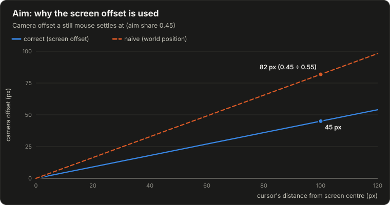</p>

```
goal = p + 0.45 * (cursor_screen - screen_center)
cam += (goal - cam) * (1 - exp(-8 * dt))
```

Shifts the camera toward the mouse cursor so you can see where you are aiming.

- A cursor 100 px from the screen centre shifts the camera 45 px.
- The rate of 8 (half-life about 0.09 s) is fast so the camera answers the mouse quickly.
- **Pitfall: do not use the cursor's world position.** `cursor_world = cam + offset`, so the cursor's world position moves when the camera moves. Writing `goal = p + 0.45 × (cursor_world − p)` makes the camera chase itself even with a still mouse. It settles at `0.45 / (1 − 0.45) ≈ 0.82` of the offset, far past the intended 0.45 (the right animation and the dashed line). Turn on "naive implementation" in the aim parameters to see it.
- Without a mouse, a gamepad stick or a locked-on enemy can serve as the same "aim point".

### 8. Two targets

<p align="center">
  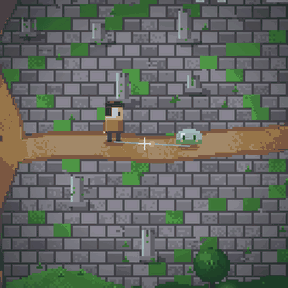
  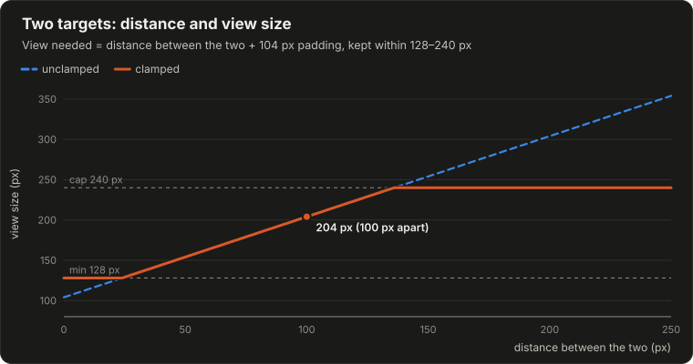
</p>

```
dx = q.x - p.x;  dy = q.y - p.y
need = clamp(max(|dx|, |dy|) + 104, 128, 240)
view += (need - view) * (1 - exp(-3.5 * dt))
cam  += ((p + q) / 2 - cam) * (1 - exp(-4.5 * dt))
zoom  = 128 / view
```

Keeps two targets on screen at once, as in two-player co-op. In the animation the camera zooms out as the slime buddy walks away and zooms back in as it returns.

- The camera follows the midpoint of the two.
- The view size needed is the distance between them (the larger of the two axes) plus 104 px of padding. The view is square, so the larger axis decides.
- The view stays within 128–240 px. Without a cap it grows without limit as the two drift apart (the dashed line). 100 px apart gives a 204 px view (about 0.63× zoom); 200 px apart hits the 240 px cap.
- Position and view size are eased at separate rates.
- If the buddy is further than the cutoff distance (400 px in this demo), it is dropped and the camera follows the player alone.
- **Pixel-art caveat:** the zoom is no longer a whole number, so pixels blur or come out uneven. Either accept that, or limit zoom to whole-number steps.

### Pixel snapping

Eased cameras come to rest at fractional positions such as 0.37 px. In pixel art this shows up as pixels shimmering.

- Round the camera to whole pixels only when drawing; keep the float value for the maths.
- **Round the characters the same way, not just the camera.** Rounding only one of them shifts their relative position by a pixel at a time, and the characters appear to shake.
- Press P to toggle it and compare.

### In game engines (from the article)

| Mode | Godot 4 | Unity Cinemachine |
| --- | --- | --- |
| Smooth | `position_smoothing_speed = 2.6` | Damping `4.605 / 2.6 ≈ 1.77` |
| Dead zone | drag margins `0.34375` / `0.28125` | Damping 0, Dead Zone `(0.34375, 0.28125)` |
| Look-ahead | Script it | Lookahead Time `0.5333`, Smoothing `4` (velocity-based) |
| Two targets | Script it | Target Group + Group Framing, Ortho Size `4–7.5` (16 px/unit) |
| Rooms, points of interest, aim | Script it | Move a focus object in LateUpdate, running before the CinemachineBrain |

## Files

| File | Contents |
| --- | --- |
| `camera.js` | The camera: all eight modes, pure logic with no rendering |
| `world.js` | Procedural pixel-art world and ambient effects (fireflies, snow, cloud shadows) |
| `sprites.js` | The hero, the slime, and the points of interest (crystals, chest, campfire, portal, statue) |
| `main.js` | Game loop, input, rendering and UI |
| `test.mjs` | Tests against the article's numbers |
| `serve.mjs` | Dependency-free static file server |
| `scripts/make-figures.mjs` | Generates the README charts from `camera.js` |
| `docs/` | README images (`figures/` for charts, `media/` for animations) |

The game itself uses no image files. All its art is drawn in code.

## Tests

```bash
node test.mjs
```

The tests check the article's numbers, for example:

- Smooth: a 100 px jump is within 1 px after 107 ticks
- Room by room: a 128 px slide takes 33 ticks; no movement inside a room
- Look-ahead: the lead is 30.9 px after 1 s, walking or running
- Points of interest: the settled offset is 14.0 px at 40 px and 14.4 px at 24 px
- Aim: a cursor 100 px away gives 45 px (the naive version overshoots to 0.82)
- Two targets: 100 px apart gives a 204 px view; 200 px apart stops at the 240 px cap
- With distances and shares at 0, every mode matches the locked camera

## How the figures are made

- **Charts:** `node scripts/make-figures.mjs` writes SVGs to `docs/figures/ja/` and `docs/figures/en/`. They plot the real `Camera` from `camera.js` stepped at 60 Hz, so changing the code changes the figures.
- **Animations:** in the browser, set `lab.state.paused = true`, advance one tick at a time with `lab.step()`, draw with `lab.draw()`, save the canvas frame by frame, and assemble the frames into a GIF (15 fps).

## Debugging

From the browser console, `window.lab` exposes the camera and state.

```js
lab.setMode('poi');     // switch mode
lab.teleport(78, 330);  // jump next to the campfire
lab.cam.params.poi.pull = 1;

lab.state.paused = true; // pause,
lab.step(10);            // advance 10 ticks,
lab.draw();              // and draw
```
