# 2D Camera Follow Lab

**日本語** | [English](README.en.md)

**▶ ブラウザで遊ぶ: https://kumi0708.github.io/2d-camera-follow-lab/**

<p align="center">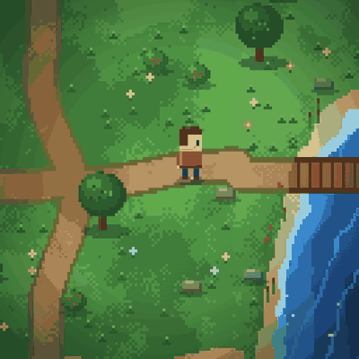</p>

2D ゲームのカメラ追従を、同じ世界の中で 8 種類切り替えて比べられるデモです。
SpriteCook の記事「[2D camera follow: dead zone & look-ahead](https://www.spritecook.ai/blog/2d-camera-follow-dead-zone-look-ahead)」の内容を実装しています。

このページのアニメーションはすべてデモの実画面で、グラフはすべて `camera.js` を実際に動かして描いています（作り方は[図の作り方](#図の作り方)）。

## 起動

ES モジュールを使うので、ローカルサーバー経由で開きます（依存パッケージはありません）。

```bash
node serve.mjs
```

ブラウザで http://localhost:8123 を開きます。ポートは `PORT` 環境変数か第 1 引数で変更できます。

## 操作

| キー | 動作 |
| --- | --- |
| WASD / 矢印キー | 移動 |
| Shift | ダッシュ |
| 1〜8 | モード切替 |
| IJKL | 相棒スライムを操作（2ターゲット用） |
| マウス | エイム |
| G | デバッグ表示の切替 |
| P | ピクセルスナップの切替 |
| R | リセット |

右側のパネルで、モードごとのパラメータをスライダーでその場で調整できます。カメラとプレイヤーのずれのグラフと、ミニマップもあります。

## モード一覧

既定値は 128×128px のビュー、60 tick/秒を前提にしています。ピクセル値はビューの大きさに合わせて拡大縮小してください。

| # | モード | 仕組み | 既定値 |
| --- | --- | --- | --- |
| 1 | ロック | `cam = p` | — |
| 2 | [スムーズ](#2-スムーズ) | プレイヤーへ指数イージング | rate 2.6/秒 |
| 3 | [デッドゾーン](#3-デッドゾーン) | プレイヤーを中心にした箱の中にカメラをクランプ | 半幅 x 22px, y 18px |
| 4 | [部屋ごと](#4-部屋ごと) | 部屋の中心へ smoothstep でスライド | 部屋 128px, 0.55 秒 |
| 5 | [先読み](#5-先読み) | 移動「方向」だけを見て前方へリード | 32px, rate 3.4/秒 |
| 6 | [注目点](#6-注目点) | 近くの見どころへ smoothstep の重みで引き寄せ | 60px→24px, pull 0.6, rate 3.5 |
| 7 | [エイム](#7-エイム) | カーソルの画面オフセットの一定割合だけずらす | 0.45, rate 8 |
| 8 | [2ターゲット](#8-2ターゲット) | 中点を追い、距離に応じてズームアウト | 余白 104, ビュー 128〜240px |

## 技術解説

### アニメーションの見方

各モードのアニメーションにはデバッグ表示（G キー）が出ています。

| 表示 | 意味 |
| --- | --- |
| 白い十字 | カメラの中心（画面の中心） |
| 黄色の点と点線 | 目標（goal）。カメラはこの点へ近づく |
| 水色の破線の箱 | デッドゾーン |
| 紫の破線 | 部屋の境界 |
| ピンクの矢印 | 先読みのリード |
| 緑の円 | 注目点の影響範囲（外側 60px、内側 24px） |
| オレンジの照準 | マウスカーソル |
| 水色の線 | 2ターゲットの 2 人を結ぶ線 |

グラフの青い線がプレイヤー、オレンジの線がカメラです。

### 共通の土台：目標とイージング

記事の中心にある考え方は、**どのモードも「目標（goal）を決める」と「そこへ近づく（ease）」の 2 段に分けられる**ということです。モードごとに違うのは目標の決め方だけで、近づき方はほぼ共通です。

```
goal = モードごとの計算(p, ...)
cam += (goal - cam) * (1 - exp(-rate * dt))
```

<p align="center">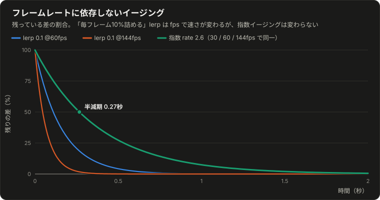</p>

**なぜ指数関数を使うのか。** よく見かける `cam = lerp(cam, goal, 0.1)` は「1 フレームごとに差の 10% を詰める」書き方です。上のグラフのとおり、これだと 60fps と 144fps で追従の速さが変わってしまいます。rate を「毎秒」の値として持ち、`1 - exp(-rate·dt)` を掛ければ、dt をどう刻んでも同じ時間で同じだけ近づきます（緑の線は 30・60・144fps で完全に重なります）。

- 残っている差は `exp(-rate·t)` で減っていきます。
- 差が半分になるまでの時間（半減期）は `ln2 / rate` です。rate 2.6 なら約 0.27 秒です。
- 差が 1% になるまでの時間は `ln(100) / rate ≈ 4.605 / rate` です。Unity Cinemachine の Damping（時間で指定）に換算するときはこの式を使います。

**rate が 0 のときは即座に目標へ合わせます。** 式どおりだと係数が 0 になってカメラが止まってしまうので、特別扱いしています（`camera.js` の `ease()`）。

**距離や割合を 0 にすると、どのモードもロックと同じ動きになります。** 記事が勧めている確認方法で、`test.mjs` で全モードを検証しています。

**更新の順番。** 固定タイムステップ（60Hz）で「入力 → プレイヤー移動 → カメラ更新 → 描画」の順に処理します。カメラをプレイヤーより先に更新すると 1 tick 分遅れた位置を映すことになり、画面がちらつきます。画面揺れなどの演出は、計算したカメラ位置に上乗せするもので、上書きしてはいけません。

### 1. ロック

```
cam = p
```

最も単純な追従で、ほかのモードを比べるときの基準です。プレイヤーの細かい動きやジャンプがすべてそのまま画面に伝わります。

### 2. スムーズ

<p align="center">
  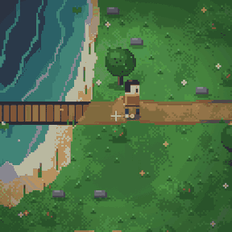
  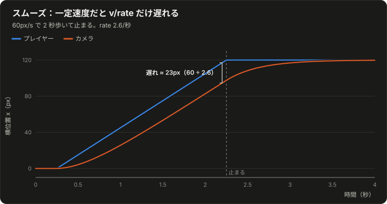
</p>

```
cam += (p - cam) * (1 - exp(-2.6 * dt))
```

プレイヤーの位置を目標にして、指数イージングで追いかけます。アニメーションでは、ダッシュ中はプレイヤーが画面の右へ寄り、止まるとカメラが追いついてきます。

- 60Hz では 1 tick あたり差の約 4.24% を詰めます。
- 100px 離れた状態から 1px 以内に入るまで 107 tick（約 1.78 秒）です。
- **常に少し遅れます。** 一定速度 v で動き続けると、遅れは `v / rate` に落ち着きます。歩き（60px/s）なら約 23px（グラフ）、ダッシュ（150px/s）なら約 58px 後ろになり、ダッシュでは画面の端（64px）近くまでプレイヤーが寄ります。速いゲームで rate を上げる必要があるのはこのためです。
- Godot の `position_smoothing_speed` は `speed × delta` の線形な割合で詰めるので、同じ 2.6 でも 1 tick 約 4.33%、104 tick と少し違う動きになります。

### 3. デッドゾーン

<p align="center">
  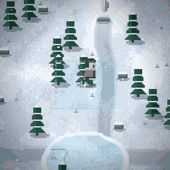
  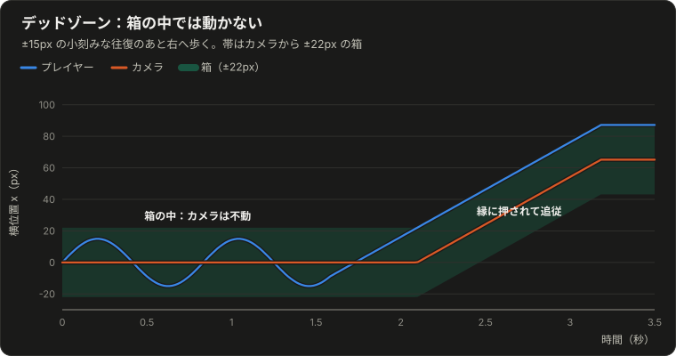
</p>

```
cam.x = clamp(cam.x, p.x - 22, p.x + 22)
cam.y = clamp(cam.y, p.y - 18, p.y + 18)
```

カメラの周りに見えない箱（44×36px、ビューの約 3 分の 1）があると考えます。アニメーションの水色の箱がそれです。

- プレイヤーが箱の中にいる間、カメラは一切動きません（グラフ前半の平らな部分）。少し歩いたり、その場でジャンプしたりしても画面が揺れません。
- 箱から出ると、カメラはプレイヤーに押されて箱の縁に張り付いたまま、同じ速さで動きます。遅れは最大でも箱の半幅です。
- イージングを使わないので、プレイヤーが止まるとカメラもその場でぴたりと止まります。
- 縦と横の大きさは別々に決められます。
- Godot では drag margin で同じことができます。値は「画面の半分に対する割合」なので、`22 / 64 = 0.34375`、`18 / 64 = 0.28125` です。

### 4. 部屋ごと

<p align="center">
  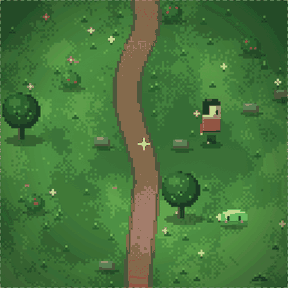
  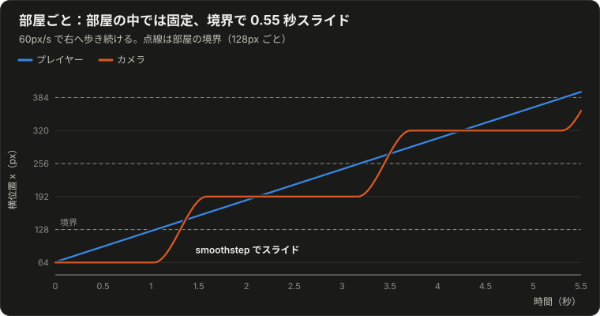
</p>

```
center = floor(p / ROOM) * ROOM + ROOM / 2
if center != room_to:
    room_from = cam; room_to = center; t = 0
t += dt
cam = lerp(room_from, room_to, smoothstep(min(t / 0.55, 1)))
```

画面を部屋単位で固定する、昔ながらの見下ろし型アクションでおなじみの方式です。

- 部屋（128px 四方）の中では、カメラはまったく動きません（グラフの平らな段）。
- 境界を越えると、0.55 秒（33 tick）かけて隣の部屋の中心へスライドします。
- `smoothstep(t) = t²(3 − 2t)` は始点と終点で速度が 0 になる曲線なので、「止まる → 動く → 止まる」という自然な動きになります（グラフの段差の角が丸くなっている部分）。
- スライドの起点を「現在のカメラ位置」にしているので、スライド中に境界を行き来しても途切れずに向きを変えます。
- 最初の tick は、開始した部屋へスライドせずに合わせます。スライド時間を 0 にすると、境界を越えた tick で画面が切り替わります。

### 5. 先読み

<p align="center">
  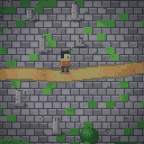
  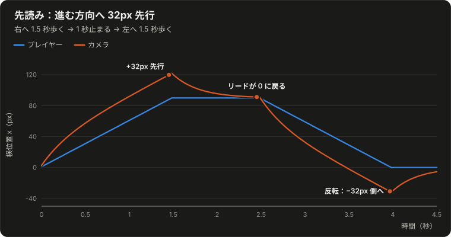
</p>

```
moved = p - last_p;  last_p = p
goal_lead = moved が 0 でなければ normalize(moved) * 32、そうでなければ (0, 0)
lead += (goal_lead - lead) * (1 - exp(-3.4 * dt))
cam = p + lead
```

進んでいる方向の先を多めに見せる方式です。アニメーションのピンクの矢印がリード（ずらす量）です。

- **見るのは移動の「方向」だけで、速さは使いません。** 歩いても走っても、リードは同じ 32px（ビューの 4 分の 1）です。
- カメラ位置そのものではなく、**リードだけをイージング**します。カメラはプレイヤーに固定されたまま、前方へのずれだけが滑らかに変わります。
- 歩き始めて 1 秒でリードは 30.9px、止まって 1 秒で約 1px まで戻ります。
- 向きを反転すると、リードは反対側へ滑らかに移ります。中央を通過するまで約 0.2 秒（`ln2 / 3.4`）です。
- `last_p` は移動量を計算した後に保存します。
- Unity Cinemachine の Lookahead は速度から未来の位置を予測するので、速く動くほどリードが伸びます（60px/s で 32px なら、3 倍の速さで約 92px）。一定のリードにしたい場合は、記事のように別の追従対象（フォーカス用オブジェクト）を動かす方法を使います。

### 6. 注目点

<p align="center">
  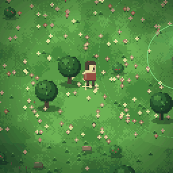
  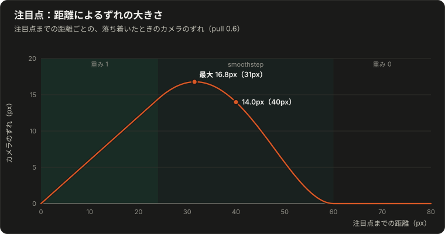
</p>

```
goal = p
for o in 注目点:
    w = smoothstep(60, 24, distance(o, p))   // 60px で 0、24px で 1
    goal += (o - p) * w * 0.6
cam += (goal - cam) * (1 - exp(-3.5 * dt))
```

宝箱や焚き火などの近くに行くと、カメラがそちらへ少し寄ります。アニメーションの緑の円が影響範囲（外側 60px、内側 24px）です。

- 重み w は、60px より遠いと 0、24px より近いと 1 で、その間は smoothstep で滑らかにつながります。
- ずれの大きさは `距離 × w × 0.6` です。40px で 14.0px、24px で 14.4px になります。約 31px で最大（約 17px）になり、それより近づくと `0.6 × 距離` で小さくなっていきます。注目点の真上に立つと、カメラはプレイヤーに戻ります。
- 注目点が複数あるときは、それぞれのずれを足し合わせます。
- pull を 0 にすると機能がオフになります。
- **落とし穴：** 2 つの注目点を引き寄せ範囲より近くに置くと、カメラが両者の間で揺れることがあります。注目点同士は離して置きます。

### 7. エイム

<p align="center">
  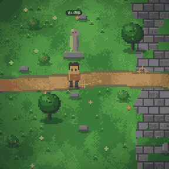
  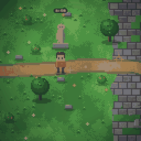
</p>
<p align="center"><sub>左：正しい実装（画面オフセット）　右：素朴な実装（ワールド座標）。照準の動きは同じ</sub></p>

<p align="center">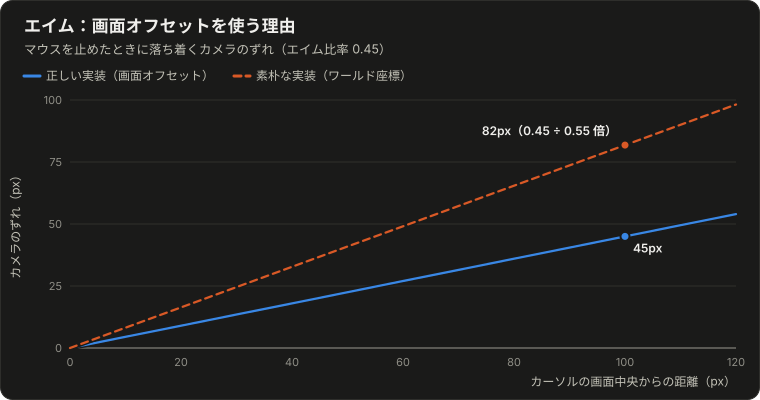</p>

```
goal = p + 0.45 * (cursor_screen - screen_center)
cam += (goal - cam) * (1 - exp(-8 * dt))
```

マウスカーソルの方向へカメラをずらし、狙っている先を見やすくします。

- カーソルが画面中央から 100px 離れていれば、カメラは 45px ずれます。
- rate 8（半減期約 0.09 秒）と速めにして、マウスの動きにすぐ応えるようにしています。
- **落とし穴：ワールド座標のカーソルを使ってはいけません。** `cursor_world = cam + オフセット` なので、カメラが動くとカーソルのワールド座標も一緒に動きます。`goal = p + 0.45 × (cursor_world − p)` と書くと、マウスを止めていてもカメラが自分自身を追いかけ、`0.45 / (1 − 0.45) ≈ 0.82` 倍の位置で止まります。狙いの 0.45 倍を大きく通り過ぎます（右のアニメーションとグラフの破線）。パラメータ欄の「素朴な実装」をオンにすると、この挙動を体験できます。
- マウス以外では、ゲームパッドのスティックやロックオン中の敵の位置を、同じ「狙う点」として使えます。

### 8. 2ターゲット

<p align="center">
  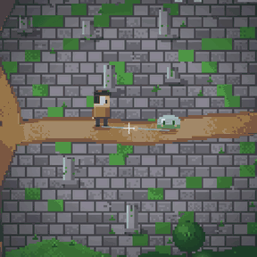
  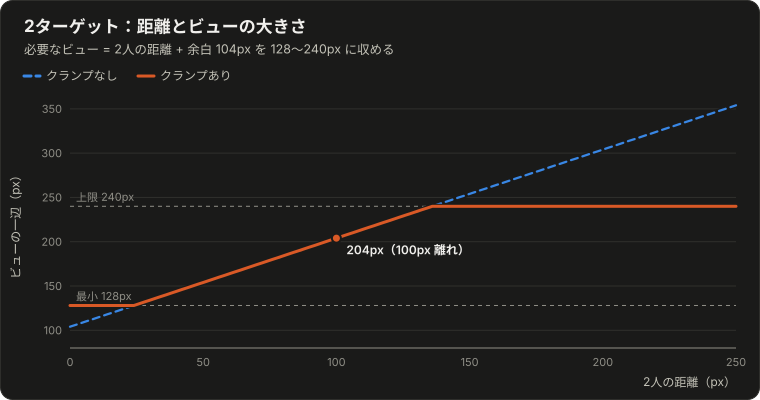
</p>

```
dx = q.x - p.x;  dy = q.y - p.y
need = clamp(max(|dx|, |dy|) + 104, 128, 240)
view += (need - view) * (1 - exp(-3.5 * dt))
cam  += ((p + q) / 2 - cam) * (1 - exp(-4.5 * dt))
zoom  = 128 / view
```

2 人協力プレイなどで、2 つの対象を同時に画面に入れる方式です。アニメーションでは、相棒のスライムが離れるとズームアウトし、戻ってくるとズームインします。

- カメラは 2 人の中点を追います。
- 必要なビューの大きさは「2 人の距離（縦横の大きい方）＋ 余白 104px」です。ビューが正方形なので、縦横の大きい方を使います。
- ビューは 128〜240px に収めます。上限がないと、2 人が離れるほど際限なく広がります（グラフの破線）。100px 離れるとビュー 204px（ズーム約 0.63 倍）、200px 離れると上限の 240px になります。
- 位置とビューの大きさは、別々の rate でイージングします。
- 相棒が切り離し距離（このデモでは 400px）より離れたら、2 人目を対象から外してプレイヤーだけを追います。
- **ピクセルアートでの注意：** ズームが整数倍でなくなるので、ドットが滲んだり不揃いになったりします。それを受け入れるか、ズームを整数倍の段階に限定します。

### ピクセルスナップ

イージングを使うと、カメラは 0.37px のような中途半端な位置に止まります。ピクセルアートではこれがドットの揺れとして見えます。

- 描画するときだけカメラ位置を整数に丸め、計算には小数のまま使います。
- **カメラだけでなく、キャラクターも同じように丸めます。** 片方だけ丸めると、両者の位置関係が 1px 単位でずれ、キャラクターが揺れて見えます。
- P キーでオン・オフを切り替えて違いを確認できます。

### ゲームエンジンでの対応（記事より）

| モード | Godot 4 | Unity Cinemachine |
| --- | --- | --- |
| スムーズ | `position_smoothing_speed = 2.6` | Damping `4.605 / 2.6 ≈ 1.77` |
| デッドゾーン | drag margin `0.34375` / `0.28125` | Damping 0、Dead Zone `(0.34375, 0.28125)` |
| 先読み | スクリプトで実装 | Lookahead Time `0.5333`、Smoothing `4`（速度依存） |
| 2ターゲット | スクリプトで実装 | Target Group ＋ Group Framing、Ortho Size `4〜7.5`（16px/unit） |
| 部屋ごと・注目点・エイム | スクリプトで実装 | フォーカス用オブジェクトを LateUpdate で動かし、CinemachineBrain より先に実行する |

## ファイル構成

| ファイル | 内容 |
| --- | --- |
| `camera.js` | カメラ本体（8 モード、描画に依存しない純粋なロジック） |
| `world.js` | 手続き生成のピクセルアートの世界と環境演出（蛍、雪、雲の影など） |
| `sprites.js` | 主人公、スライム、注目点（結晶、宝箱、焚き火、転移門、石像）の描画 |
| `main.js` | ゲームループ、入力、描画、UI |
| `test.mjs` | 記事の数値を再現できているかのテスト |
| `serve.mjs` | 依存なしの静的ファイルサーバー |
| `scripts/make-figures.mjs` | README のグラフを `camera.js` から生成する |
| `docs/` | README の画像（`figures/` がグラフ、`media/` がアニメーション） |

ゲーム本体は画像ファイルを使っておらず、絵はすべてコードで描いています。

## テスト

```bash
node test.mjs
```

記事の数値と照合します。たとえば次のような値です。

- スムーズ：100px 離れた位置に 1px 以内まで近づくのに 107 tick
- 部屋ごと：128px のスライドに 33 tick、部屋の中では動かない
- 先読み：歩きでも走りでも、1 秒後のリードは 30.9px
- 注目点：落ち着いたときのずれは 40px で 14.0px、24px で 14.4px
- エイム：100px 先のカーソルで 45px（素朴な実装では 0.82 倍まで行き過ぎる）
- 2ターゲット：100px 離れるとビュー 204px、200px 離れると上限の 240px
- 距離や割合を 0 にすると、全モードがロックと一致する

## 図の作り方

- **グラフ：** `node scripts/make-figures.mjs` で `docs/figures/ja/` と `docs/figures/en/` に SVG を書き出します。`camera.js` の `Camera` を 60Hz で実際に動かした結果を描いているので、コードを変えれば図も変わります。
- **アニメーション：** ブラウザで `lab.state.paused = true` にして、`lab.step()` で 1 tick ずつ進め、`lab.draw()` で描いたキャンバスを 1 コマずつ保存し、GIF にまとめたものです（15fps）。

## デバッグ

ブラウザのコンソールで `window.lab` からカメラや状態を触れます。

```js
lab.setMode('poi');     // モード切替
lab.teleport(78, 330);  // 焚き火の近くへ瞬間移動
lab.cam.params.poi.pull = 1;

lab.state.paused = true; // 一時停止して
lab.step(10);            // 10 tick 進め
lab.draw();              // 描画する
```
